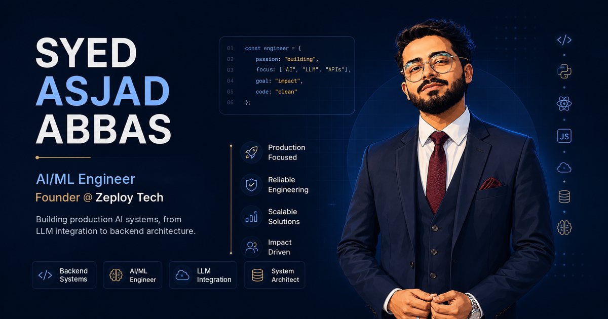

<div align="center">

<a href="https://www.syedasjadabbas.dev/">
  
</a>

# syedasjadabbas.dev

**Portfolio of Syed Asjad Abbas, AI/ML & Backend Engineer**

Production AI, backend systems and the engineering decisions behind them.

[](https://www.syedasjadabbas.dev/)
[](https://www.linkedin.com/in/syed-asjad-abbas/)
[](https://www.syedasjadabbas.dev/assets/syed-asjad-abbas-resume.pdf)


</div>

---

## Overview

This repository is the source of [syedasjadabbas.dev](https://www.syedasjadabbas.dev/). It's a hand-built static site, with no framework and no build step.

It isn't a template. Each project is presented the way an engineer would review it, covering:
- the problem;
- the architecture;
- the trade-offs;
- the measured results;
- a full case study page and a downloadable case study PDF.

I'm an AI/ML Engineer at **SVYPE** and Founder & Lead Engineer of **[Zeploy Tech](https://zeploy.tech)**, and I'm completing a BS in Computer Science at COMSATS University Islamabad.

---

## Featured Work

| Project | What it is | Engineering highlight | Case study |
|:---|:---|:---|:---:|
| **MockAI** | Multimodal AI interview evaluation (final year project) | Scores content (DistilBERT), delivery (speech pace, pauses, fillers) and composure (YuNet + FERPlus), fused 50 / 30 / 20 into an explainable report. Degrades gracefully when the camera or microphone is missing | [Read](https://www.syedasjadabbas.dev/case-study/mockai/) |
| **ZePlay** | Adaptive video streaming platform | Throughput up 7.7× (84 → 650 req/s) at 500 concurrent users with 0% failures in local k6 load tests. Keyset pagination cut deep-page queries from ~295 ms to 0.27 ms | [Read](https://www.syedasjadabbas.dev/case-study/zeplay/) |
| **Serene Management** | Hotel property management system | Idempotent billing so no payment is charged twice. Search went from 8.3 s to 0.45 s, with 50 req/s and zero errors on a single instance | [Read](https://www.syedasjadabbas.dev/case-study/serene-management/) |
| **FlightOne** | AI travel platform | The AI assistant (Ava) plans the trip, but the server calculates every fare, so the model never generates a price | [Read](https://www.syedasjadabbas.dev/case-study/flightone/) |
| **Zee** | AI assistant on zeploy.tech | Gemini streaming responses, conversation history cleaning, and an automatic fallback model when the primary model fails | [Live](https://zeploy.tech) |

The site also covers EduCart, TuneBox, FrameGrill, the Gym Management System and other client and academic work, each with its own case study page.

---

## Site Highlights

**Design and interaction**
- A Three.js wireframe hero scene and a typed-text headline. Section reveals use `IntersectionObserver`.
- Respects `prefers-reduced-motion`, so animation is reduced for visitors who ask for it.
- Fully responsive down to small phones, with a dedicated mobile navigation overlay.
- DM Sans for text and JetBrains Mono for technical details.

**Content**
- Projects are written as engineering case studies, not screenshots: the problem, the architecture, decisions, results and limitations.
- Every flagship project has a downloadable PDF case study in `assets/case-studies/`.
- A one-page resume is served directly from the site.

**SEO and sharing**
- Unique title, description and canonical URL on every page.
- Open Graph and Twitter Card tags, with a dedicated 1200×630 share image per case study.
- JSON-LD structured data: `WebSite`, `ProfilePage`, `Person`, `Organization` and `ItemList` on the homepage, and a `TechArticle` on each case study.
- `sitemap.xml`, `robots.txt`, a custom 404 page and verified Google Search Console indexing.

**Performance**
- No framework and no bundler: three static files plus images.
- WebP project images and a local copy of `three.min.js`.
- Clean URLs through Vercel (`cleanUrls`, `trailingSlash`).

---

## Project Structure

```
asjad-portfolio/
├── index.html                 # Homepage: hero, about, skills, projects, experience, contact
├── style.css                  # Design system, layout, responsive rules, animations
├── script.js                  # Three.js hero, typed text, scroll reveals, navigation
├── 404.html                   # Custom not-found page
├── case-study/
│   ├── mockai/                # One folder per project, each with index.html
│   ├── zeplay/
│   ├── serene-management/
│   ├── flightone/
│   └── ...
├── assets/
│   ├── case-studies/          # Downloadable PDF case studies
│   ├── og/                    # 1200×630 social share images per case study
│   ├── og-image.png           # Homepage share image
│   ├── *.webp                 # Project showcase images
│   ├── three.min.js
│   └── syed-asjad-abbas-resume.pdf
├── sitemap.xml
├── robots.txt
└── vercel.json                # Clean URLs and trailing slash
```

---

## Run Locally

No install and no build. Serve the folder with any static server:

```bash
git clone https://github.com/syedasjadabbas/asjad-portfolio.git
cd asjad-portfolio

# Either of these works
npx serve .
python -m http.server 8000
```

Then open `http://localhost:3000` if you used `serve`, or `http://localhost:8000` if you used Python.

Case study links use clean URLs (`/case-study/zeplay/`). These resolve to each folder's `index.html` on both a local server and Vercel.

---

## Deployment

The site deploys on **Vercel**. Every push to `main` triggers a production deploy, and `vercel.json` sets the URL behaviour:

```json
{
  "cleanUrls": true,
  "trailingSlash": true
}
```

When you add a new page, also add its URL to `sitemap.xml` and resubmit the sitemap in Google Search Console.

---

## Contact

Open to AI/ML and backend engineering roles, and to businesses that want an AI prototype or a manual process turned into something real users can rely on.

- **Website:** [syedasjadabbas.dev](https://www.syedasjadabbas.dev/)
- **LinkedIn:** [linkedin.com/in/syed-asjad-abbas](https://www.linkedin.com/in/syed-asjad-abbas/)
- **Email:** [asjadabbaszaidi@gmail.com](mailto:asjadabbaszaidi@gmail.com)
- **Studio:** [Zeploy Tech](https://zeploy.tech)

---

## Usage

The code is public for reference and learning. The written content, case studies, project images, resume and personal branding are © Syed Asjad Abbas and may not be reused or republished without permission.

<div align="center">
<sub>Designed and built by Syed Asjad Abbas · Lahore, Pakistan</sub>
</div>
